# 12 — Remediation Dependency DAG & Phased Action Programme (v2.0)

**Authority:** Founder Constitutional Remand — Programme Restructuring  
**Lifecycle Invariants:**
- Canonical L01–L19 lifecycle preserved.
- Sentium remains strictly frozen.
- Career Intelligence acceptance mission remains strictly frozen.
- Read-Only Phase: Zero general remediation code executed until Founder ratifies this revised DAG.

---

## 1. Master Remediation Dependency DAG (9 Phases)

```mermaid
flowchart TD
    subgraph Phase1["Phase 1: Audit Meta-Verification & Minimum Firewall"]
        P1_1["P1.1: Heterogeneous Review of 13 Audit Deliverables"]
        P1_2["P1.2: Minimum Completeness Firewall (CF-01..CF-06 in L11/L13/L16)"]
    end

    subgraph Phase2["Phase 2: Estate Identity, State & Authority Resolution"]
        P2_1["P2.1: Ratify 5-Tuple Resolution Manifest for All Subsystems"]
        P2_2["P2.2: Archive /Users/bob/GitHub/SAKG and Concept Graph Specs"]
        P2_3["P2.3: Disposition Library of Fire Logical vs Physical Corpus"]
        P2_4["P2.4: Explicit Non-Blocking Disposition of SDCG (CLRS Prototype)"]
    end

    subgraph Phase3["Phase 3: Orca–PAEOS Boundary Design"]
        P3_1["P3.1: Codify Mission Control vs Engineering Authority Division"]
        P3_2["P3.2: Implement Task Classifier (Engineering vs Domain Cognition)"]
        P3_3["P3.3: Design Actual Operational Transport (Orca -> PAEOS Intake)"]
    end

    subgraph Phase4["Phase 4: Orca Runtime & Founder UX Grounding"]
        P4_1["P4.1: Eliminate Home Mock Cards (Wire dynamic spend & capacity)"]
        P4_2["P4.2: Eliminate Cockpit Fake Event Ticker (Wire real DB events)"]
        P4_3["P4.3: Fix Topbar CSS Collision & Add React Error Boundaries"]
        P4_4["P4.4: Controlled Idea OS DB Cutover (Dual-read -> Parity -> Cutover)"]
    end

    subgraph Phase5["Phase 5: Substrate Capability Completion"]
        P5_1["P5.1: SAKG Automated Continuous Extraction & Graph Queries"]
        P5_2["P5.2: Concept OS Persistent State Realization (concept.db)"]
        P5_3["P5.3: Inspiration Engine Distillation & Contradiction Pipeline"]
        P5_4["P5.4: Idea OS Synthesis Robustness (Non-JSON Error Handling)"]
        P5_5["P5.5: KAE Acquisition Ingestion Beyond Citation Anchoring"]
    end

    subgraph Phase6["Phase 6: Product, Code-Quality & Recovery Remediation"]
        P6_1["P6.1: Pass Council Plans to Backend (End Discard Defect)"]
        P6_2["P6.2: Replace Silent Stub Fallbacks with Visible Failures"]
        P6_3["P6.3: Decompose God-Files (main.tsx, orchestrator.py)"]
        P6_4["P6.4: Convert Blocking HTTP Workflows to BackgroundTasks"]
        P6_5["P6.5: Fix SSE SQLite WAL Transaction Snapshot Staleness"]
    end

    subgraph Phase7["Phase 7: Missing Verification-Class Implementation"]
        P7_1["P7.1: Implement Headless Browser Suite (Playwright for Orca)"]
        P7_2["P7.2: Implement Concurrency & Stream Freshness Test Suite"]
        P7_3["P7.3: Implement PAEOS Trace-B Full-Ceremony Operability Suite"]
        P7_4["P7.4: Implement Derived Performance SLO Benchmarks"]
    end

    subgraph Phase8["Phase 8: Full Live Founder Journey Execution"]
        P8_1["P8.1: Live Founder Journey End-to-End Across Real Transports"]
        P8_2["P8.2: Human Pause at Decision Gate Verification"]
        P8_3["P8.3: Non-Vacuous Evidence Minting in SAKG"]
    end

    subgraph Phase9["Phase 9: Genuine Heterogeneous Estate Audit & Seal"]
        P9_1["P9.1: Live Heterogeneous L14 Audit (Gemini via Admitted Transport)"]
        P9_2["P9.2: Issue Non-Vacuous Estate Completeness Seal under Firewall"]
    end

    Phase1 --> Phase2
    Phase2 --> Phase3
    Phase3 --> Phase4
    Phase4 --> Phase5
    Phase5 --> Phase6
    Phase6 --> Phase7
    Phase7 --> Phase8
    Phase8 --> Phase9
```

---

## 2. Phase Deliverables & Exit Gates

### Pre-P2 autonomy readiness gate (Founder roadmap amendment, 2026-09-10)

`P1_QUALIFIED` does not transition directly to P2. The bounded work-package gate in
`PRE_P2_AUTONOMY_READINESS_GATE_PLAN.md` must qualify first. It operationalizes only the minimum
delegated-authority, Founder-stop, gap-classification, remediation-submission, checkpoint/resume,
Architect/Council/adversarial, provider-recovery, and L17/L18 learning machinery needed for
unattended P2→P9 execution. It adds no L01–L19 state and excludes the future proactive Weakness
Finder, estate-wide optimization, and convergence work.

The gate requires physical demonstrations of ordinary repair, novel in-authority architectural
repair, verifier/oracle repair, provider failure recovery, child-to-parent resume, recurrence
learning, and Founder-reserved stop with a minimal decision packet. Its exit is
`PRE_P2_AUTONOMY_READINESS_GATE_QUALIFIED` or a remand that keeps P2–P9 blocked.

| Phase | Phase Focus | Key Deliverables & Exit Gates |
| :--- | :--- | :--- |
| **Phase 1** | **Audit Meta-Verification & Minimum Firewall** | Heterogeneous review of audit deliverables; `PRE_AUDIT_COMPLETENESS` checks active in L11/L13; promotion gate in L16. |
| **Phase 2** | **Estate Identity, State & Authority Resolution** | 5-tuple resolution manifest committed; external SAKG/Concept Graph repos archived; LOF corpus disposition ratified; SDCG non-blocking status sealed. |
| **Phase 3** | **Orca–PAEOS Boundary Design** | Authority contract ratified: Orca owns interaction/coordination; PAEOS owns engineering governance & binding model routing. Engineering missions routed to PAEOS via operational transport proof. |
| **Phase 4** | **Orca Runtime & Founder UX Grounding** | Home tab displays 100% dynamic metrics; fake event ticker removed; topbar CSS layout fixed; React Error Boundaries added; 6-step controlled DB cutover (`command_center.db` $\to$ `idea_os_canonical.db`). |
| **Phase 5** | **Substrate Capability Completion** | SAKG automated extraction operational; `concept.db` persisted on disk; Inspiration Engine contradiction/distillation active; Idea OS synthesis robust to non-JSON output; KAE acquisition scope realized. |
| **Phase 6** | **Product, Code-Quality & Recovery** | Council plan execution verified; silent stub fallbacks replaced with visible failures; blocking workflows offloaded to BackgroundTasks; SSE stream snapshot staleness resolved; god-files modularized. |
| **Phase 7** | **Missing Verification-Class Implementation** | Playwright browser test suite passing; concurrency test suite passing; Trace-B full-ceremony execution passing; performance benchmark suite passing. |
| **Phase 8** | **Full Live Founder Journey Execution** | Complete live Founder Journey passes: Launch $\to$ Inspect Real State $\to$ Create Mission $\to$ Decompose $\to$ PAEOS Execution $\to$ Policy Routing $\to$ Decision Gate Pause $\to$ Evidence Minting $\to$ Reflection. |
| **Phase 9** | **Heterogeneous Estate Audit & Seal** | Independent audit receipt captured via live model router (`Builder != Auditor`); Verification Court issues ratified Estate Completeness Seal. |
