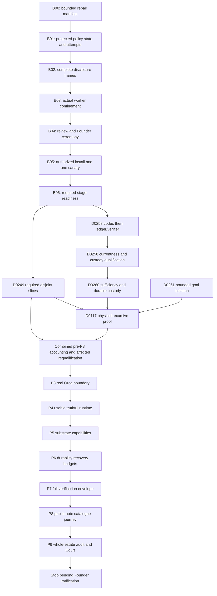

# PAEOS P1–P9 Luna Execution Guide

> **For agentic workers:** Use `superpowers:executing-plans` for a serial package, or `superpowers:subagent-driven-development` for genuinely disjoint work. These skills do not replace PAEOS admission, L01–L19, review or Court. Steps use checkboxes; checking a box creates no authority.

**Goal:** Deliver the existing pre-Sentium P1–P9 programme through real PAEOS execution, with a useful verified Founder journey, then stop pending Founder ratification.

**Architecture:** Preserve existing domain ownership, canonical runtime state, lifecycle and Policy Router. Repair the minimum supervised execution boundary first; use it for the DEBT-0258 contract codec; earn unattended operation through durable accounting, recovery and physical recursive-remediation proofs. This document is an execution aid, never a second scheduler, admission system or qualification ledger.

**Tech stack:** Existing Python >=3.12 project (captured environment Python3.13), SQLite/WAL, CAS, Ed25519, macOS process confinement, pytest/Ruff; Orca TypeScript/React and its existing Python backend. Pin actual interpreter/dependencies in each task. Do not upgrade tools as incidental cleanup.

**Spec:** Human-approved corrected P1–P9 plan in this chat; the October12 reconciliation preserved in [the programme snapshot](2026-10-18-luna-guide/programme-source.md); existing constitution, lifecycle, debt and phase manifests. [Source inventory](2026-10-18-luna-guide/source-inventory.json) records what was inspected. Later explicit human decisions supersede stale launch instructions, including removal of ChatBridge and rejection of a separate signer account.

## Read this first

This is a complete programme route, with detailed immediate repair contracts and phase-specific implementation cards. It is **not a promise that Luna or the remaining quota can finish all P9**. A strong plan reduces repeated decisions; it cannot pre-decide an unknown security finding, invent a missing authority or replace heterogeneous review. If a listed design invariant fails, use the escalation table instead of improvising a bypass.

Read this file, then only the next eligible card in [bootstrap and execution readiness](2026-10-18-luna-guide/bootstrap.md), [debt and phase work](2026-10-18-luna-guide/work-packages.md), and [operating runbook](2026-10-18-luna-guide/operations.md). Do not repeatedly load all past chats, all review archives or the whole programme. The [execution map](2026-10-18-luna-guide/execution-map.json) is a dependency index, not runtime state.

**First next task: B00.** Capture a bounded repair contract and its source/test manifest from the current candidate; then B01 implements protected public-policy state and atomic attempt accounting using synthetic data. Keep production egress denied. Founder-key setup is not a prerequisite to these offline tests.

## Global constraints

- Source checkpoint: `2ec6ca1a6e8ecb3eff611781e0c59905dbd0c19b`, branch `codex/p1-bound-source-recovery-20261018`, candidate `/Users/bob/.codex/worktrees/p1-bound-source-recovery/paeos`. Main `/Users/bob/GitHub/paeos` is dirty and is not an implicit dependency or integration destination.
- User changes Astra to Luna. Crossing80% usage is expressly allowed for **preparing this guide**. For subsequent Luna execution, the user's stated intent permits using the remaining reserve for bounded progress; record the actual model change and remaining allocation before resumption. Do not silently spend it on Astra or transfer this exception to paid APIs. No guarantee about model efficiency, account-wide reservation or P9 completion is made.
- No paid fallback, ChatBridge, Claude/Cline subscription dependency, Glimmer download, Sentium activation or Career mission. No external publication is authorized by the catalogue mission.
- No separate macOS user. Backup decryption and Founder signing are different keys. Private material never enters prompts, logs, tests, Git or reviewer packets. Only synthetic keys in tests.
- Existing qualified P1/PRE-P2/P2 claims are preserved where bindings remain valid. Requalify affected claims; do not restart the programme because an older document says P1 remanded. Conversely, an October12 summary alone is not the missing qualification receipt.
- PAEOS owns state/routing/retries; models are replaceable compute. Preserve L01–L19. Builder/Auditor family constraints remain applicable regardless of chat/model names. Bootstrap Security Review is not automatically L14.
- Physical observation, Court adjudication, integration and qualification are separate facts. A queue receipt is not receiver start. A report is not an admission. A test pass is not a phase seal.
- Retain exact original findings. No suppression, rewritten verdict, manufactured provenance or success-shaped fallback. Count actual `Sealed`, `Remanded`, `Remediated`; never optimize for zero remands.
- No new ID, new chat, TTL, transport or retry may clear a reserved/sent/consumed/UNKNOWN operation. Reconcile first.
- Explicit Git manifests only, `/usr/bin/git`, no force push, no `git add -A`. Public source/evidence backups exclude runtime archives, databases, credentials, raw private responses and keys.

## Review focus

1. Worker chooses a public key, revision, label or route: B01/B02 must reject it before signing or transmission.
2. Innocent prompt plus secret-bearing attachment, tool result, environment or readable file: B02/B03 reject or prevent access; scan results are not classification authority.
3. Process dies between reserve/send/receipt: B01/B05/P6 preserve uncertainty and logical identity; no blind replay.
4. Old source, stale lease or a new chat appears current: B00/D258-C/P0 require source, lineage, ownership and qualification joins.
5. Green fixture-only tests conceal missing integration: D117/P3/P4/P8/P9 require actual process/browser/transport behavior and discriminating negatives.

## Current evidence, not future claims

| Area | Verified source/evidence state | Remaining work |
|---|---|---|
| Recovery source | `2ec6ca1a` pushed; prior fresh sparse readback matched49 artifact hashes plus manifest | Future packages need their own push/readback |
| Public policy loading | Dormant strict Ed25519/public-document loader; historical180 focused passes | Enrollment, protected pin source, currentness/revocation and production enforcement |
| Response/model identity | Signed response binding; server-reported model parser and per-request receipt enforcement; historical138 focused passes | Live route qualification and exact installed executable binding |
| Integrated suite | Latest integrated run exit2 with7 collection errors | Four `contracts.adapters` imports and three `runtime.transport` imports; historical22-error run remains historical |
| Production egress | Explicit unconditional denials retained | No positive production permission is claimed |
| USB | Backup key copied/reopened/verified; encrypted keys volume returned locked | Founder key absent; encrypted runtime backup/restore not established |
| Debt work | Preserved candidates, some focused tests and observations | Fresh scope/admission, independent review, integration, adjudication and qualification |

The candidate lacks parts of main's source closure. Do not copy modules until imports stop failing. Each restored file needs exact origin/hash, necessity, scope and secret/quarantine review. `runtime.transport` and `contracts.adapters` are not proof that all their consumers should be enabled.

## Dependency route

Two deliberate cycle breaks:

- Bootstrap disclosure attempts belong in existing router storage; do not require Chat1's missing ledger API merely to run Chat1's first task. Do not edit Chat1-owned kernel APIs from the bootstrap lane.
- D0117 requires specific D0249 slices, not D0249's final qualification. The combined qualification happens after D0117 contributes its proof. Full D0261 concurrency qualification is later; fix its goal-selection defect before the D0117 single-goal proof.

## Who acts

| Role | Existing chat / owner | Responsibility |
|---|---|---|
| Completion coordinator | `PAEOS completion overseer`, `01a14f33-dc16-7281-9da8-a241ef9a8b0e` | Single executable queue, verify callbacks, wake only eligible owner |
| Bootstrap integrator | `Assign PAEOS pre-P3 workers`, `01a1403f-1034-74c2-95ce-bd0f705dbaef` | B00–B06 candidate; hand off after readiness |
| D0258 sole integrator | `Chat 1 — DEBT-0258 implementation recovery`, `01a147d5-525b-7e31-9fb1-80de3a325e51` | Codec/support APIs/supersession integration |
| D0249 | `Pre-P3 worker — DEBT-0249 task admission`, `01a14042-702b-72b2-b6fe-4a421e74c4f7` | Eligible D0249 slices and16-domain account |
| D0260 | `01a14042-dc90-7e31-a02d-ae046f4855a4` | Wake only after D0258 qualifies |
| D0117 | `01a14042-e4a4-76b2-abf6-c3949fc745da` | Physical autonomy composition after dependencies |
| Free-route owner | `Resolve worker-pool review route`, `01a13075-533b-72a1-b8f8-8f109414f707` | Verify exact route/privacy/free entitlement before any probe |
| Admission / custody specialists | Chat3 `01a0f35b-57da-7c52-a9c2-f1131c008069`; Chat4 `01a0f35b-f3d9-79f2-8a59-86ac1a8226c9` | Scoped supporting packages; Chat1 integrates D0258 |
| Programme records | `Manager`, `01a103eb-a3e5-7c43-b375-3548eebd1a0e` | Obligation/phase records, no competing dispatch loop |

Live chat metadata confirms current Chat1 explicitly succeeds archived `01a14087-85a2-7d30-968e-dd4ed0be6426`. The October15 continuity file's older owner is historical; do not wake it. Later phase implementation owners are selected by existing domain ownership at the phase gate, not by inventing one chat per phase.

Default active model work: one Builder plus the required reviewer. Disjoint deterministic preparation can run in parallel. A second Builder requires disjoint path leases, independent budget and no dependency conflict. Preserve the existing event-driven coordinator; hourly fallback is recovery detection, not the primary scheduling loop.

Until durable budget/recovery claims qualify, run bounded supervised packages with explicit persisted attempt ceilings and verified checkpoints. The D0117 physical experiment can prove a bounded autonomous chain without claiming general unattended operation or laptop-loss resilience. P6 broadens and qualifies those operational guarantees; any guarantee required by an earlier phase must already hold for that earlier frozen envelope.

## How Luna executes one card

1. Read current notebook/remands, router invariants, card, exact source baseline and current authoritative disposition. Reconcile drift once, not the whole programme.
2. Freeze the bounded contract: objective/claim, owner, base and preimages, mutable/read-only/forbidden paths, dependencies, stage qualifications, disclosure class/destination, tests/negative controls, budget/attempt limit, rollback and evidence joins.
3. If offline bootstrap authority applies, use only the isolated repair candidate and synthetic tests. Otherwise obtain genuine PAEOS admission and use its emitted workspace. A native chat dispatch is not that admission.
4. Add the specified regression; demonstrate the baseline failure or missing capability in the isolated environment. Implement the smallest change. Do not reduce acceptance to make it pass.
5. Run focused tests and static checks, capture exact candidate, then the relevant integrated regression once. Run the full suite after integration; report actual failures. Inspect tests before execution for host-state/provider effects.
6. Capture/push the explicit sanitized package. Review exact bytes under the applicable contract. Repair within authorized scope/budget; preserve findings. Changed bytes require the applicable fresh evidence.
7. Single owner integrates only after required disposition; recheck affected bindings. Physical Court observation does not authorize self-integration.
8. Send one material completion/blocker callback. Persist `ALLOWED_NOW`, `HELD`, `AUTHORITY_OR_IMPLEMENTATION_GAP`, owner and exact wake condition. Coordinator verifies it, then starts the next eligible card.

Do not output a new programme plan after every card. Amend only the affected card when new evidence changes a dependency or interface, with a short reason and preserved history.

## Decisions Luna may make and must not make

| Observation | Action without human nudge | Escalation boundary |
|---|---|---|
| Ordinary scoped defect with reproducible failure | Fix/test through admitted lifecycle and remaining budget | New authority, protected path or changed acceptance |
| Test fails because environment imports dirty main | Repair isolated test environment/import fence | Never enable host imports to get green |
| Interface differs from pinned predecessor | Stop dependent edits; compare exact schemas; adapt within frozen API semantics | Schema migration/hash change not already covered |
| Security finding | Preserve, reproduce, classify affected claims | Bootstrap fresh review actionable finding: hold install/canary and return finding before further review-driven edits unless newly authorized |
| Missing/expired route | Hold only dependent stage; record authoritative reset/availability condition | No paid/same-family/auto-router substitution |
| Ambiguous external effect | Preserve reservation and query original executor | Never infer failure or retry from timeout |
| Missing human key ceremony | Finish synthetic implementation and review first; present exact tested commands | Human creates private key/passphrase and approves signed policy |
| Missing trusted authority or isolation | Produce concrete smallest decision packet; continue unrelated eligible source work | No self-enrollment, worker classification or unrestricted-shell exception |
| Luna cannot resolve a security/architecture question | Save minimal reproducible packet; defer to existing strong architect/reviewer when eligible | No speculative implementation; no repeated weaker-model voting |
| Budget unavailable | Checkpoint and hold new model admissions | No new chat to reset allocation; no Astra continuation under Luna reserve intent |
| P9 qualifies | Produce final package and stop | Founder ratification, Career and Sentium remain separate |

## Completion and cost discipline

Measure useful progress as reviewed/integrated/qualified claims with evidence, not chat count or test totals. Keep construction, review and qualification costs attributable to one root. Preserve unknown expenditure. Task contracts narrow existing attempt ceilings; the bootstrap canary has exactly one provider attempt and no blind retry.

For Luna, send one card plus a compact dependency packet, not the entire history. Use local commands for search/format/checks. Batch independent reads. Do not launch model-based status summaries, polling reviews or duplicate critics. Reserve strong reasoning for a concrete unresolved design/security question. A Luna review is not heterogeneous merely because Astra built the code; verify actual model family.

A complete P9 handoff requires: reconciled P1/PRE-P2/P2 claims, all required pre-P3 dispositions, phase obligation coverage, actual P3/P4/P8 journeys, P5 capability evidence, P6 recovery/budget drills, P7 environment-bound verification, independent whole-estate audit, Court disposition, regression results, remaining lawful debt/deferrals and exact `PRE_SENTIUM_ECOSYSTEM_COMPLETE_PENDING_FOUNDER_RATIFICATION` state.

This guide alone satisfies none of those gates. Its immediate success is that the next executor can start B00's exact scope/fence work and then B01 without another broad planning round. Stable programme/corpus lineage across phases does not authorize replay of an already consumed mission; each phase proof uses a genuinely admitted execution or a recorded lawful continuation.
