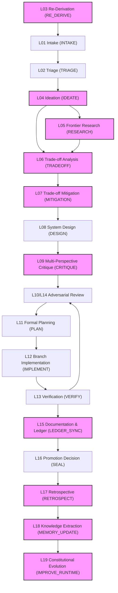

# 03_MISSING_DEPENDENCIES: The Dependency DAG

This document analyzes the dependency graph for the missing constitutional layers identified in `02_IMPLEMENTATION_MATRIX.md`. The goal is to determine the natural implementation order based on dataflow and architectural prerequisites.

## Missing Layer Dependency Analysis

The missing layers fall into three primary groups: The **Cognition Pipeline** (L03-L07, L09), the **State Synchronization** (L15), and the **Evolution Loop** (L17-L19).

### 1. The Cognition Pipeline (L03-L07, L09)
These layers represent the deep-reasoning phases before formal design and implementation. They operate sequentially.

*   **L03 First-Principles Re-Derivation (`RE_DERIVE`)**:
    *   **Depends on**: `RAW` (Implicit entry point for substantial features).
    *   **Provides for**: `INTAKE`.
*   **L04 Ambitious Ideation (`IDEATE`)**:
    *   **Depends on**: `TRIAGE`.
    *   **Provides for**: `RESEARCH`, `TRADEOFF`.
*   **L05 Frontier Research (`RESEARCH`)**:
    *   **Depends on**: `IDEATE`. (Research is targeted at ideated solutions).
    *   **Provides for**: `TRADEOFF`.
*   **L06 Trade-off Analysis (`TRADEOFF`)**:
    *   **Depends on**: `IDEATE`, `RESEARCH`.
    *   **Provides for**: `MITIGATION`.
*   **L07 Trade-off Mitigation (`MITIGATION`)**:
    *   **Depends on**: `TRADEOFF`.
    *   **Provides for**: `DESIGN` (L08).
*   **L09 Multi-Perspective Critique (`CRITIQUE`)**:
    *   **Depends on**: `DESIGN` (L08).
    *   **Provides for**: `ADVERSARIAL_REVIEW` (L10).

### 2. State Synchronization (L15)
*   **L15 Documentation & Ledger (`LEDGER_SYNC`)**:
    *   **Depends on**: `VERIFY` (L13) / `ADVERSARIAL_REVIEW` (L14).
    *   **Provides for**: `SEAL` (L16). (Ensures records are integrated before sealing).

### 3. The Evolution Loop (L17-L19)
These layers represent the system's self-improvement mechanisms, running post-execution.

*   **L17 Retrospective & CER (`RETROSPECT`)**:
    *   **Depends on**: `SEAL` (L16) (or a terminal failure).
    *   **Provides for**: `MEMORY_UPDATE` (L18).
*   **L18 Knowledge Extraction (`MEMORY_UPDATE` / `EVOLVE`)**:
    *   **Depends on**: `RETROSPECT` (L17).
    *   **Provides for**: Context injection in future loops (Scars, Templates).
*   **L19 Constitutional Evolution (`IMPROVE_RUNTIME` / `RESTART`)**:
    *   **Depends on**: Triggered by L18 or external founder proposal.
    *   **Provides for**: Upgraded system components and rules.

## Dependency DAG (Mermaid)

