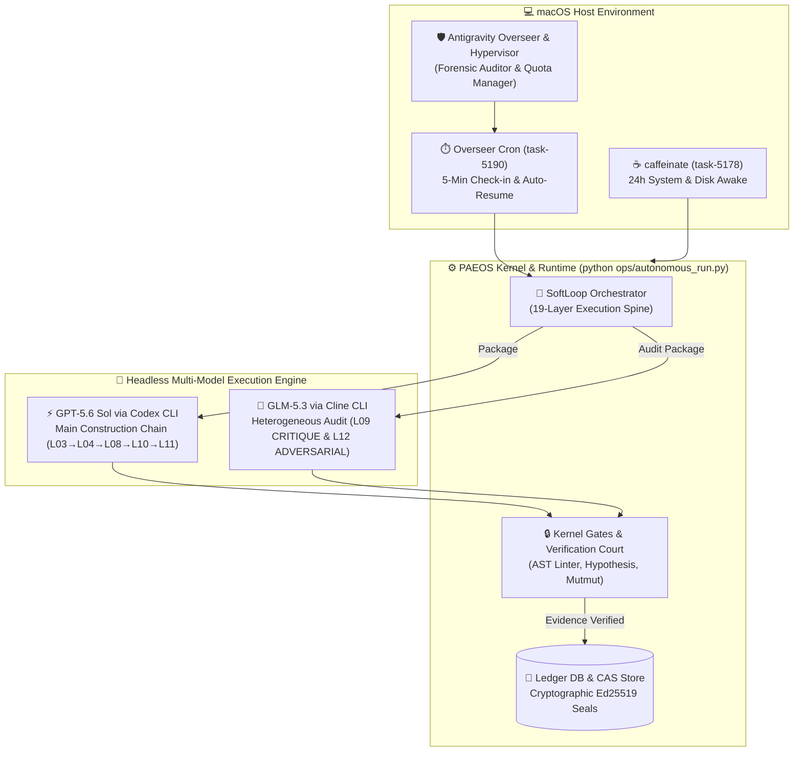

# 📐 PAEOS-9B — Multi-Model Runtime Architecture & Autonomous Self-Hosting Specification (v1.0)

**Document Status:** Historical architecture specification; lifecycle descriptions are non-authoritative.
**Lifecycle authority:** `operations/ENGINEERING_LIFECYCLE.md` v1.3 and validly ratified
amendments within their lawful scope, per Founder disposition of PAEOS-IP-0017. The historical
layer labels and diagrams below are retained for provenance and must not govern execution.
**System Version:** PAEOS v5.0 (19-Layer Canonical Execution Spine)  
**Host Environment:** macOS (AArch64) · Python 3.13 Virtualenv (`uv`)  
**Overseer Agent:** Google Antigravity (Overseer & Hypervisor)  

---

## 1. System Architecture Overview



---

## 2. Component Specifications

### 2.1 The PAEOS Autonomous Execution Engine
PAEOS (Predictable Autonomous Engineering Operating System) is a self-hosting engineering operating system governed by a canonical 19-layer execution spine.

* **Execution Driver**: [`ops/autonomous_run.py`](file:///Users/bob/GitHub/paeos/ops/autonomous_run.py)
* **Core Orchestrator**: [`runtime/orchestrator/__init__.py`](file:///Users/bob/GitHub/paeos/runtime/orchestrator/__init__.py) (`SoftLoop`)
* **Court Verification Pool**: [`runtime/verification.py`](file:///Users/bob/GitHub/paeos/runtime/verification.py) & [`kernel/sandbox.py`](file:///Users/bob/GitHub/paeos/kernel/sandbox.py)
* **State Machine & Ledger**: SQLite hash-chained ledger [`kernel/ledger.py`](file:///Users/bob/GitHub/paeos/kernel/ledger.py) + Content-Addressed Storage [`kernel/cas.py`](file:///Users/bob/GitHub/paeos/kernel/cas.py)
* **Friction & Debt Collector**: [`runtime/friction.py`](file:///Users/bob/GitHub/paeos/runtime/friction.py) (RB-0008)

#### The 19-Layer Canonical Spine:
1. **`L01 INTAKE`**: Objective parsing & validation
2. **`L02 TRIAGE`**: Weight-class classification (`ROUTINE`, `SUBSTANTIAL`, `KERNEL_TOUCHING`)
3. **`L03 RE_DERIVE`**: Re-derivation of constitutional invariants
4. **`L04 IDEATE`**: Candidate approach discovery ($\ge 3$ solutions)
5. **`L05 RESEARCH`**: Self-hosting criteria evaluation
6. **`L06 TRADEOFF`**: Adversarial trade-off analysis
7. **`L07 MITIGATION`**: Safeguard & fallback cataloguing
8. **`L08 DESIGN`**: Master specification authoring (`design/d.md`)
9. **`L09 CRITIQUE`**: **Heterogeneous Adversarial Audit** of design spec across 8 stances (Security, Performance, Simplicity, Maintainability, Testability, Backward Compatibility, Constitutional Alignment, Functionality)
10. **`L10 PLAN`**: Step-by-step file work unit compilation (`plan/p.md`)
11. **`L11 IMPLEMENT`**: Code file authoring & test generation
12. **`L12 ADVERSARIAL_REVIEW`**: **Heterogeneous Code Audit** & Court Sandbox Verification
13. **`L13 SEAL`**: Cryptographic Ed25519 seal & commit
14. **`L14–L19`**: Retrospective, Evolution Layer, Ledger Sync, Improve Runtime/Restart

---

### 2.2 Stage-Aware Multi-Model Routing Strategy

PAEOS uses **Heterogeneous Review + Single-Engine Construction** to maximize quality while eliminating cognitive blindspots:

```text
 ┌─────────────────────────────────────────────────────────────┐
 │ MAIN CONSTRUCTION CHAIN (GPT-5.6 Sol via Codex CLI)         │
 │ • L03 RE_DERIVE   • L04 IDEATE     • L08 DESIGN             │
 │ • L10 PLAN        • L11 IMPLEMENT                           │
 │ Throughput: 34.6 SOTA on Terminal-Bench 3.0, zero drift    │
 └──────────────────────────────┬──────────────────────────────┘
                                │ Spec & Diffs
                                ▼
 ┌─────────────────────────────────────────────────────────────┐
 │ HETEROGENEOUS ADVERSARIAL AUDIT (GLM-5.3 via Cline CLI)     │
 │ • L09 CRITIQUE             • L12 ADVERSARIAL_REVIEW         │
 │ Role: Orthogonal weight distribution catches main model      │
 │       training blindspots & un-logged exception fallbacks   │
 └──────────────────────────────┘
```

#### Multi-Provider Runtimes ([`runtime/integrations/hybrid.py`](file:///Users/bob/GitHub/paeos/runtime/integrations/hybrid.py)):
* **`CodexRuntime`**: Headlessly dispatches `codex exec <prompt> --json --dangerously-bypass-approvals-and-sandbox` in isolated temporary workspaces.
* **`GlmRuntime`**: Headlessly dispatches `cline -p <prompt> --model glm-5.3 --json --dangerously-skip-permissions` for audit stages.
* **`HybridRuntime`**: Stage-aware router directing stages dynamically.

---

### 2.3 Machine-Checkable Verification Court (CANARY-0002 Compliance)

To ensure no weak, lazy, or vacuous code passes into the ledger, every build is subjected to **4 deterministic Court gates**:

1. **`PaeosAstLinter`** ([`runtime/ast_linter.py`](file:///Users/bob/GitHub/paeos/runtime/ast_linter.py)): Statically inspects Python Abstract Syntax Trees to reject `except Exception: pass`, bare `except:`, and un-logged fallback returns before tests run.
2. **`Hypothesis` Property Tests** ([`tests/kernel/`](file:///Users/bob/GitHub/paeos/tests/kernel/)): Fuzzes 1,000s of adversarial input combinations against kernel invariants and shrinks minimal reproducing edge cases.
3. **Discriminative Mutation Checks (`vacuous_commands`)** ([`runtime/verification.py`](file:///Users/bob/GitHub/paeos/runtime/verification.py)): Asserts that every submitted unit test MUST fail when code is mutated or reverted, defeating vacuous test suite cheats (CANARY-0002).
4. **Pyright Match Exhaustiveness** ([`pyproject.toml`](file:///Users/bob/GitHub/paeos/pyproject.toml)): Enforces closed `Enum` pattern matching (`match/case`) with `reportMatchNotExhaustive = true`.

---

### 2.4 Antigravity Overseer & Hypervisor Protocol

**Role**: Host Overseer, Hypervisor, and Pair Programmer  
**Rule Specifications**: Loaded globally via [`~/.gemini/config/rules/antigravity_overseer_role.md`](file:///Users/bob/.gemini/config/rules/antigravity_overseer_role.md) and [`AGENTS.md`](file:///Users/bob/GitHub/paeos/AGENTS.md).

#### Hypervisor Responsibilities:
1. **Continuous Daemon Awake**: Keeps `caffeinate -dimu -t 86400` running in background (`task-5178`).
2. **5-Minute Check-in Cron**: Runs `Cron: */5 * * * *` (`task-5190`) to inspect `task-5230` logs, resolve deadlocks, and verify Court evidence pool status.
3. **Automated Quota Reset Management**:
   * Detects `429 Rate Limit` or `Quota Exceeded` on GPT-5.6 Sol or GLM-5.3.
   * Pauses 5-min check-in cron during wait window to conserve tokens.
   * Sets one-shot timer for 1 min after reset time.
   * Auto-rebuilds and restarts `autonomous_run.py` upon wake-up.
4. **Forensic Logging**: Audits all repo changes into [`MessyChangesNeedsReview.md`](file:///Users/bob/GitHub/paeos/MessyChangesNeedsReview.md).
